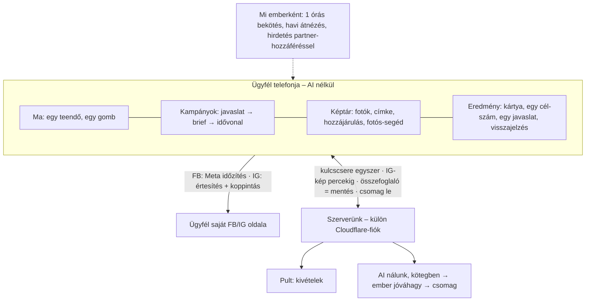

# Zsebmarketing – egységes terv (öt osztály + összefésülés) · 2026-11-27
Állapot: AI-javaslat (Claude), Péter jóváhagyására vár. Péter (11-27): „ez nem csak egy kampánymenedzser, hanem egy zsebmarketing… mindenki a saját területéért feleljen, a gondolatokat ütköztessétek… a végén szülessen meg a tökéletes megoldás… összefüggőnek kell lenni.”
Osztályok: Termék és felület · Marketing és tartalom · Technológia és működés · Jog és adat · Üzlet és ügyfélút (külön ügynökök, ugyanazon alapanyagból: KESZ-TERMEK, KEPESSEGTERKEP, KAMPANYMENEDZSER, MOTOR-ATADO).

## Ütközések és döntésem (ahol egyértelmű, eldöntöttem – Péter felülírhatja)
| Ütközés | Kik | Döntés |
|---|---|---|
| Teljes brief, több nyelv/csatorna vs. „egy teendő, egy gomb” | Marketing ↔ UX | Brief 5 mező, előre kitöltve, haladó rész összecsukva; a Ma mindig csak egy teendőt mutat |
| „Automatikus posztolás” vs. iPhone (nincs háttérfutás), IG-nek nincs időzítés | Marketing ↔ Tech ↔ Üzlet | Asszisztált: FB Meta-időzítéssel, IG értesítés + koppintás; NEM hívjuk „automatának” (Fttv.) |
| Élő kamera vs. iOS PWA-hibák | Marketing ↔ Tech | Natív kamera + utólagos program-ellenőrzés; élő segéd később, böngészőlapon kísérletként |
| Hozzájárulás-lépések vs. egyszerűség | Jog ↔ UX | Egyszeri hozzájárulások bekötéskor; posztnál egy „Jóváhagyom”; képtárban kis ikon; arcos fotó soha nem megy automatán |
| Automatikus közzététel felelőssége | Jog ↔ Üzlet | Jóváhagyott keret (sablon + fotók + napok), visszavonható, naplózva; fizetett tartalom mindig kézi |
| Több nyelv | Marketing | Organikusan külön HU/EN/DE poszt; fizetettnél egy hirdetéscsoport nyelvváltozatokkal; szöveg soha nem a képen |
| Párhuzamos fizetett kampányok | Marketing ↔ Üzlet | Ügyfelenként 1 aktív fizetett kampány, a többi sorban |
| Képarány | Marketing ↔ Tech | Feed 4:5, reel/story 9:16 |
| Mi hagyja el a telefont | Tech ↔ Jog | Számok + szövegek (mentés) igen; képek csak IG-közzétételig (R2, utána törlés); számláló IP nélkül |
| Közös Cloudflare-fiók más projekttel | Tech | Külön fiók a Zsebmarketingnek most; fizetős szint az első fizető ügyfélnél |
| Testreszabás vs. támogatási teher | UX ↔ Üzlet | Csak márkaszín, logó, jelmondat; elrendezés közös |
| Bekötés nem skálázódik | Üzlet ↔ UX | Személyes 1 órás bekötés a pilotban, mérve; önkiszolgálás csak ha kell |
| Ígéret vs. reklámjog | Üzlet ↔ Jog | Az ígéret a rutin („mindig van mit kitenni”), nem foglalásszám |
| Első nap | UX ↔ Tech | Érték előbb: 5 perc alatt poszt-előnézet, Meta-bekötés az 1. héten |
| Siker mérése | Marketing ↔ Üzlet | Foglalási kérés/üzenet; az első 4 hét alapmérés, célszám csak utána |

## Péter döntése kell (pénz, jog, név)
1. Ár: A (14 900 / 34 900 Ft/hó + 39 000 bekötés), B (79 000 bekötés + 9 900 / 24 900), vagy kevert – javaslat: B bekötése + A havidíja; tesztelőknél bekötés ingyen, havidíj a 3. hónaptól. (becslés, a tesztelőket kérdezni)
2. Cégforma: EV marad a pilotra; cég a Meta-cégellenőrzés (Tech Provider) előtt? – javaslat: pilot EV-vel, szerepkörös tesztelőkkel; döntés az ellenőrzés előtt.
3. Tesztelői feltétel: meddig ingyen, mit adnak cserébe, írásban (könyvelő + jogász).
4. Pilot-kritérium elfogadása: mind 7 napon belül posztol; 4. héten ≥2 poszt/hét; 12. héten ≥2/3 használja; bekötés ≤4 óra; ≥2 fizetne. Bukás: kettő nem teljesül vagy bekötés >8 óra. Értékelés: a 12. hét végén (esemény, nem dátum).

## Sorrend (AI-javaslat)
1. Felület 4 fülre (Ma · Kampányok · Képtár · Eredmény) + dizájnrendszer-tokenek; kampánymenedzser (javaslat, brief, idővonal); fotós-segéd (natív kamera + ellenőrzés) – bemutató adatokkal, AI nélkül.
2. Jogi csomag v0: adatkezelési tájékoztató + tesztelői megállapodás feldolgozói résszel → szakember.
3. Külön Cloudflare-fiók; szerver: kulcscsere, összefoglaló-mentés, IG-képtár.
4. Meta-bekötés szerepkörös tesztelőkkel (FB időzítés, IG értesítés), token-őr.
5. Pilot mérése a kritériumok szerint → ár véglegesítése.

## Bizonytalan (ellenőrizendő)
Cloudflare D1/R2 pontos ingyenes korlátai; Google Cégprofil-poszt élettartama; Meta szöveghossz; page-token lejárata; AI Act (jogász); tesztelői ingyenesség adóügyi kezelése (könyvelő); Ptk./Fttv. szakaszszámok.

## Kiegészítés: mozgóképes reel (Péter, 11-27: „mozgóképes reklámot is tudnunk kell csinálni… megindítja a kamerát, elfordítja egy kicsit… így is tudunk reelt készíteni”)
AI-javaslat: a fotós-segéd kap egy **Videó** módot (rövid klipek, 3–6 mp: lassú fordulás a szobában, ajtónyitás/belépés, kilátás az ablakból, részlet), a telefon saját kamerájával; a reel-motor a fotók mellett **klipeket** is fűz (vágás a legjobb 2–3 mp-re, felirat, zene, zárókép) – a telefonon, AI nélkül (videókocka → vászon → felvétel, ahogy most a fotós reel). Kockázat: nagy fájlok és régebbi iPhone-ok teljesítménye – mérni kell. A Facebook-mintát (Péter linkje) belépés nélkül nem látjuk: képernyőfelvétel kell róla. Helye a sorrendben: 1. lépés része (fotós-segéd + reel-motor).

### Minta: Artam Luxury Cabins reel (Péter képernyőképei, 11-27) – elemzés (AI)
14 mp, álló 9:16, 4 rész: (1) kint, erdőből, lassú oldalazás az üvegfal mentén, előtérben őszi lombok (0–3 mp); (2) kint, magasról a terasz és a jakuzzi, alig mozduló kép (3–6 mp); (3) logó feketén (zárókép középen); (4) bent, tág kép, lassú fordulás a napfény felé – fényfolt, kád, kanapé (a végén). Szöveg a videón nincs, ember nincs, arany órás fény, minden mozgás lassú és egyenletes.
Szabályok a Videó módhoz (ebből): 3–5 klip × 2–4 mp, összesen 12–15 mp; kint távol → kint közel/részlet → bent tág → zárókép; lassú, egyenletes mozgás (két kézzel, könyök a testhez, lassú lépés vagy fordulás, 0,5× széles látószög); előtér-keret (ág, levél, ajtófélfa) a mélységért; fény: napsütés oldalról vagy reggel/késő délután; felirat nem a képen, hanem a leírásban vagy csak a záróképen.
