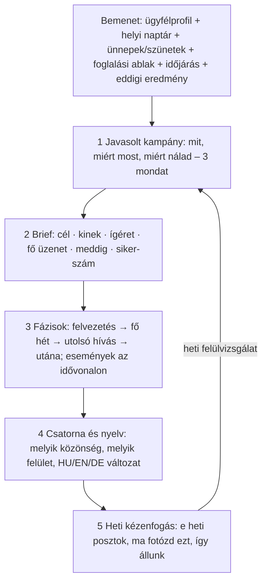

# Kampánymenedzser / kampánytanácsadó – követelmény és terv (ZSEBMARKETING, 2026-11-27)
Állapot: Péter kérése rögzítve; a terv AI-javaslat, Péter jóváhagyására vár. A Tervező 1. változata (sima 4 hetes lista) ezt NEM teljesíti – Péter: „ez csak egy sima lista… hol van itt a kampánymenedzser”.

## Te mondtad (11-27, a szavaidhoz közel)
- „nem kötötted hozzá eseményekhez, nincs benne naptár, nem tudod, hogy karácsony van… itt egy kampánymenedzserről van szó. Körül kell nézni, mi a helyzet Zebegényben, hogy néz ki a turizmus. Mindent figyelembe kell venni.”
- „az Akvarellről már van egy tonna tudásunk… fel tudjuk építeni a profilját… szedjük be az információt még.”
- „ajánlhatjuk neki: figyelj, ezt és ezt kéne csinálnod, mert Zebegényben vagy… miért ezt csináld. Az első kampány: javasoljuk, hogy így és így építsd fel. Minél tömörebben. Úgy csinálja, ahogy akarja.”
- „Ha nincs kész képe… sétálj, ma ha tudsz, csinálj egy képet… az elején leszögezzük, hogy kampányt csinálunk, innentől kézen kell fogni a felhasználót.”
- „ugyanaz a kampány többfelé megosztva, német, angol… hova kell osztani? Nézd meg, milyen beállítások vannak a Metában, a Google-ben… mit kell tudnunk, hogy tökéletes legyen a posztunk… több kampány is megy, egyik ide, másik oda.”
- Fotós-segéd: „érzi-e, jó-e a kép, kicsit hátrébb, fókusz, perspektíva, kicsit lejjebbről… mit tud egy fotós, és mit tudunk a kezébe adni.”

## Javaslatom (AI-javaslat)

- Forrás-alap: foglalási ablak – a szabadidős utazók többsége 1–3 hónappal előre tervez és foglal (TravelBoom 2026, revenue-hub.com); helyi naptár: pl. Zebegény Meseadvent 12.01–12.24 (programturizmus.hu); a kampányok szezonra előre (houfy.com playbook).
- Következő lépés (kutatás): Meta (közönség, nyelv, elhelyezés, formátum-méretek) és Google (Cégprofil-poszt, hirdetés) – mit kell tudnia a posztnak, hogy a beállításoknak megfeleljen; több párhuzamos kampány.
