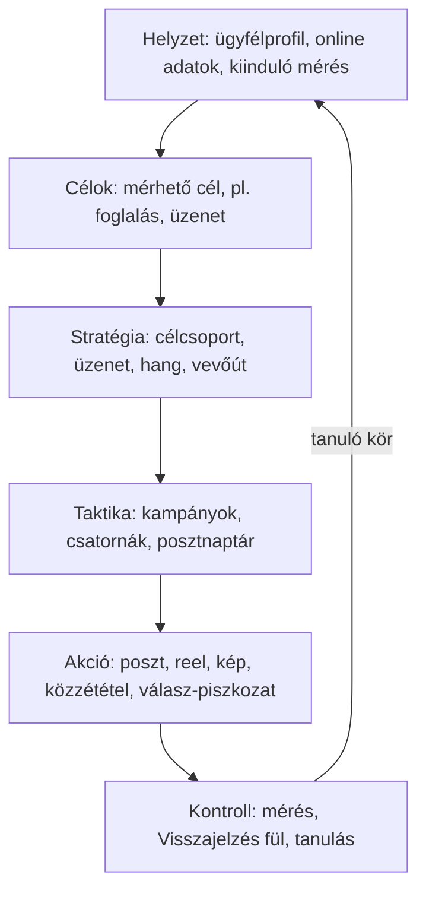

# Zsebmarketing – képességtérkép (mit kell tudnia egy teljes értékű zsebmarketinesnek)
Állapot: 2026-11-27 · ZSEBMARKETING · AI-javaslat (Claude), Péter jóváhagyására vár · váz: PR Smith SOSTAC® tervezési modell (Helyzet, Célok, Stratégia, Taktika, Akció, Kontroll), a gyár marketing-osztályának tudásával (vevőút 6 lépés, platformszabályok, mérés).
Péter kérése (11-27): „teljes értékű zsebmarketinges legyen… visszajelző felület… megbeszéljük a marketinget, ez hogy fog felkerülni, akár saját marketing generátort is lehet csinálni.”

| SOSTAC | Mit kell tudnia | Nálunk mi végzi | Állapot |
|---|---|---|---|
| Helyzet | ügyfél adatai (web, Google Cégprofil, FB), hely, versenytársak, kiinduló számok | interjú + online gyűjtés → tudáscsomag (AI egyszer, ember jóváhagy) | félig: csomag van, gyűjtő és interjú nincs |
| Célok | 1–3 mérhető cél (foglalás, üzenet, látogatás) | marketing-beszélgetés a tervezőben | nincs |
| Stratégia | célcsoport, üzenet, hangnem, vevőút | tervező (a gyár marketing-osztályának tudásával) → csomag | félig: hang/persona van |
| Taktika | kampányok, csatornák, posztnaptár, képkérés-lista | kampánygenerátor → csomag `kampanyok` | nincs |
| Akció | poszt, reel, kép 3 nyelven; közzététel, időzítés; komment/üzenet-piszkozat | motor (AI nélkül); Meta-kapcsolat a szerveren | félig: gyártás megvan, közzététel és piszkozat nincs |
| Kontroll | mérés (FB/IG, Google, weboldal), Visszajelzés fül, javaslat, tanulás | szerver napi gyűjtés → app + központi pult → tanuló kör | nincs |
| Üzemeltetés | bekötés, jogosultságok, felügyelet | mi (partner-hozzáférés, őr) | nincs |

Határok (őszintén): fizetett hirdetés beállítása ember (mi); kommentre válasz csak jóváhagyott piszkozat; profi fotózást nem vált ki.
Gyár-kötés: a marketing tudása a MARKETING + KOMMUNIKÁCIÓ chat osztályából jön (Iagent `szerepek/marketing.md`, gyar/dontesek.yaml 137: a marketing osztály általános, projekt-szabály a projektmappába) – nem építjük újra.
