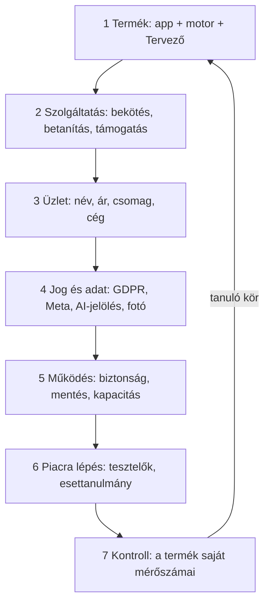
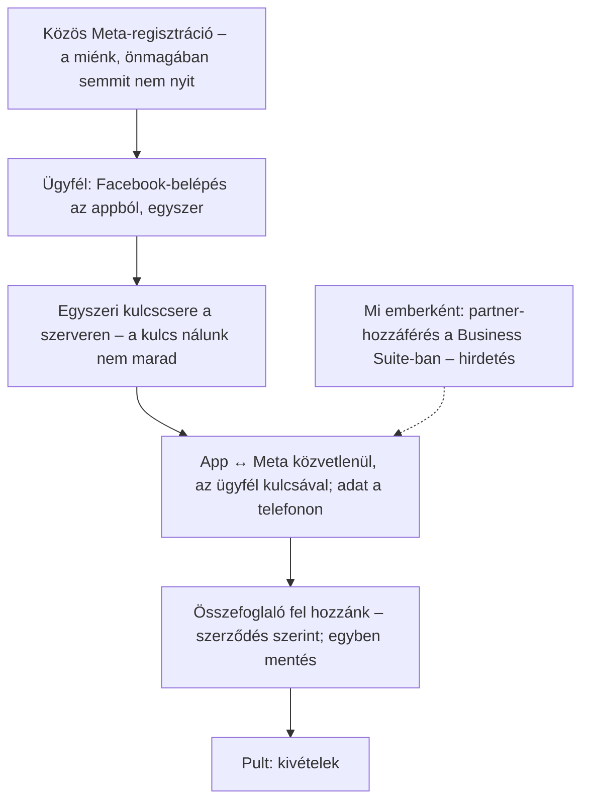

# Zsebmarketing – a kész termék térképe (mi kell a kezünkben)
Állapot: 2026-11-27 · ZSEBMARKETING · **AI-javaslat (Claude); Péter jóváhagyta 2026-11-27: „a kész termék térkép mehet”** · független ellenőr: külön ügynök kutatása (lent, „Ellenőr”).
Te mondtad (11-27): „Mire van szükségünk, minek kell a kezünkben lenni egy olyan kész terméknek, aminek ez a neve, hogy zsebmarketing… ilyen termék nincsen… azonnal kapunk tesztelőket… Minden szinten.”

Vázlat: hét réteg. Egy termék akkor „kész”, ha mind a hétben van legalább a minimum (MVP), és van mérése, hogy működik-e.

## 1. Termék
| Elem | Minimum (tesztelőkhöz) | Állapot |
|---|---|---|
| Ügyfél-app (PWA) | „Ma” kártya, fotó → poszt/reel, képtár | megvan (v17 + javítócsomag) |
| Háromrétegű motor | motor / szakmacsomag / ügyfélcsomag külön fájl | jóváhagyva, építés következik |
| Tervező | beszélgetés → SOSTAC-terv → kampány, posztnaptár, helyzetkép, képtartalék | látványterv kész, kód következik |
| Közzététel | Meta-kapcsolat (FB/IG), ütemezés | nincs – tulaj-engedély kell |
| Mérés | FB/IG számok + weboldal, napi gyűjtés | nincs |
| Visszajelzés fül | ügyfél egy gombbal jelez → hozzánk | nincs |
| Központi pult | minden ügyfél állapota, frissítés egyszerre/egyenként | nincs |
| Új szakma felvétele | szakmacsomag-sablon (szállás után: vendéglátás, autókereskedés) | nincs |

## 2. Szolgáltatás
- Bekötési menet (lépéslista, időigény mérve): fiókok, jogosultság, interjú, fotó-alapkészlet, első kampány.
- Betanítás: AI egyszer, ember jóváhagy; változáskérés útja (Visszajelzés → mi).
- Kapacitás: hány ügyfél fér egy emberre (méréssel, az első tesztelőknél).

## 3. Üzlet
- Név és logó: „Zsebmarketing” munkanév; védjegy-kereső (SZTNH) előtte. **Péter dönt.**
- Ár és csomag: havidíj + bekötési díj modell (javaslat; ellenőr adatai alapján). **Péter dönt.**
- Cégforma: Meta Tech Provider-hez ellenőrzött vállalkozás kell. **Péter dönt.**

## 4. Jog és adat
- Adatkezelési tájékoztató + adatfeldolgozói szerződés (GDPR 28. cikk) minden ügyféllel.
- Meta Platform Terms, Fejlesztői szabályzat; App Review csak sok ügyfélnél.
- AI-tartalom jelölése: EU AI Act 50. cikk (átláthatóság) – nálunk a kép valódi fotó, a szöveg programból; ellenőrizni, mi jelölendő.
- Fotó: személy csak hozzájárulással; szerzői jog az ügyfélnél.
- Reklámjog (Fttv.): nincs megtévesztés, garancia, nyomás; kommentkérés nem mehet.
- Google Maps adata nem tárolható → OSM.
Szakember nézze át, mielőtt fizető ügyfél jön (jogi osztály: nem jogi tanács).

## 5. Működés
- Kulcs/token csak titkosítva a szerveren (Cloudflare secret), soha fájlban.
- Mentés: ügyfélcsomag + képtár exportja; helyreállítási próba.
- Őr: napi ellenőrzés, hiba → jegy; takarékos AI- és Actions-használat.
- Ingyenes korlátok (Cloudflare: 100k kérés/nap, D1 10 adatbázis/fiók, közös a VH-val) → mikor kell fizetős szint.

## 6. Piacra lépés
- 1. kör: Akvarell + 1–2 tesztelő ingyen, cserébe visszajelzés és esettanulmány.
- 2. kör: más szakma (pl. vendéglátás) – az ágazatfüggetlenség próbája.
- Demó: élő telefonos bemutató az Akvarell anyagából (az ügyfél engedélyével).

## 7. Kontroll – a termék mérőszámai
- Aktiválás: bekötéstől az első kint lévő posztig eltelt napok.
- Használat: heti poszt/ügyfél; elfogadott vs. elvetett javaslat.
- Hatás: az ügyfél célja (foglalás, üzenet) a kiinduló méréshez képest.
- Megtartás: hány ügyfél használja 4 és 12 hét után.

## Brainstorm – a „többi gondolkodás” (független ellenőr, 9 keresés, 2026-11-27)
Ami a vázlatból hiányzott, és bekerül (AI-javaslat):
| Réteg | Új elem | Miért |
|---|---|---|
| Termék | Meta-token figyelés + „kapcsold újra” jelzés | a hosszú token ~60 nap, csendben is lejárhat ([Meta](https://developers.facebook.com/docs/facebook-login/guides/access-tokens)) |
| Termék | Ügyfél-jóváhagyás közzététel előtt, naplózva | a tartalomért az ügyfél felel, bizonyíték kell |
| Termék | Sikertelen közzététel: újrapróba + értesítés | API-hiba rendszeres |
| Termék | Képtárban jelölés: van-e felismerhető ember, van-e hozzájárulás | képmásjog, Ptk. 2:48. § |
| Termék | Adatexport és fióktörlés | GDPR + Meta törlési URL |
| Termék | Reel-zene csak jogtiszta | különben némítás/levétel |
| Szolgáltatás | Személyes ~1 órás bekötés | a Meta-összekötés a legnagyobb lemorzsolódási pont |
| Szolgáltatás | B2B ÁSZF, leiratkozási menet, válaszidő, helyettesítés | egyszemélyes működés kockázata |
| Üzlet | Szolgáltatás-ár (havidíj + bekötés), éves fizetés | Buffer/Later/Ocoya/Predis eszközár 6–40 USD; mi szolgáltatás vagyunk (következtetés, piaci adattal nem ellenőrzött) |
| Üzlet | Védjegy: SZTNH, 9/35/42. osztály, 81–108 ezer Ft, előtte kutatás | [díjtáblázat](https://sztnh.gov.hu/sites/default/files/dijtablazat_vedjegy.pdf); vigyázat: hamis díjbekérők |
| Jog | Adatfeldolgozók listája (Cloudflare, Meta, AI) a szerződésben; Meta éves adatvédelmi felmérés | GDPR 28. cikk, Meta Platform Terms |
| Jog | AI Act 50. cikk (2026-08-02-től): élő AI-beszélgetésnél jelezni, hogy AI; programból készült poszt valószínűleg nem jelölendő | **bizonytalan, jogász erősítse meg** |
| Működés | Fotó/videó tár: R2 (10 GB ingyen), nem D1; Workers 10 ms CPU → képfeldolgozás a telefonon marad | [Cloudflare limits](https://developers.cloudflare.com/workers/platform/limits) |
| Működés | Központi pult: szerepkör, kétlépcsős belépés, napló, fokozatos kiadás | egy hibás frissítés mindenkit érint |
| Kontroll | Aktiválás = első poszt kint az első héten; lemorzsolódás-cél havi < 2% (kkv-SaaS jellemző 3–7%) | előre leírt pilot-siker/bukás kritérium |

### A 3 alábecsült kockázat
1. **Meta – pontosítva Péter kérdésére (11-27).** Te mondtad: „ez egy sajátja lesz mindenkinek, az ő meta adatain… ugyanaz, mint hogyha egy marketinges dolgozna a felületen.” Ez így igaz a **kézi útra**: partner-hozzáférés ügyfelenként, a fiók az ügyfélé, egy ügyfél tiltása a többit nem érinti. Közös kapu csak a **gépi útnál** van: az automatikus közzététel és mérés egy **Meta-alkalmazáson** (a mi fejlesztői appunk) megy át, és ha azt a Meta felfüggeszti, egyszerre áll le minden ügyfélnél a gépi rész. Ellenszer (beépítve): a mag **Meta-kapcsolat nélkül is működik** – a telefon a kész posztot megosztással viszi a Facebookra/Instagramra, ahogy most; a gépi közzététel és mérés csak ráadás, kiesésnél a kézi út marad.
2. **Az emberi szolgáltatás ára** – bekötés, támogatás, hirdetés egy emberre; az árnak fedeznie kell.
3. **Felelősség a tartalomért** – ugyanaz, mint egy marketinges felelőssége (Péter, 11-27: „le kell zárnunk, hogy ne kerülhessen ki olyan”). Zár: a motor csak jóváhagyott mondatkészletből épít; tiltólista szakmánként (`szakma_meta.tilos`); ügyfél-jóváhagyás közzététel előtt; képmás-jelölés a képtárban.

## Sorrend (AI-javaslat)
1. Háromrétegű motor + Tervező (jóváhagyva) – benne már: jóváhagyási lépés, képtár-hozzájárulás jelölés.
2. Pilot-kritériumok leírása az Akvarell + 1–2 tesztelő elé.
3. Meta-kapcsolat partner-hozzáféréssel, token-figyeléssel, újrapróbával.
4. Jogi csomag (adatkezelési tájékoztató, adatfeldolgozói szerződés, ÁSZF) – szakember átnézi, mielőtt fizető ügyfél jön.
5. Név/védjegy, ár, cégforma – Péter dönt, a pilot adatai után.

## Mérés – hogyan, AI nélkül (AI-javaslat, Péter kérdésére, 11-27)
Mérés = számolás és összevetés, nem AI. Négy szint:
1. **Telefon (app):** mi készült, mit osztott meg, melyik javaslatot fogadta el/vetette el, milyen fotó jött. Helyben gyűlik, netnél kis csomagban felmegy hozzánk (Visszajelzés fül ugyanezen az úton).
2. **Weboldal:** a posztok linkjei kampánycímkével (utm, Akvarellen már van: `akv-foto`); kattintás, ajánlatkérés, foglalás a mi végpontunkon számolva; süti csak hozzájárulással.
3. **Meta:** ~~naponta a szerver kéri le~~ → **felülírta a 11-27-i döntés (lent):** az app kéri le megnyitáskor, az ügyfél saját kulcsával. Korlát: oldalanként 24 óra alatt 4800 × aktív felhasználó hívás – napi egy lekérés messze alatta.
4. **Értelmezés:** program szabályok (ez a hét vs. kiinduló szint, mi ment jól, mi nem) → javaslatkártya az appban. AI csak ritkán, központilag, a szabályok javítására.
**500 ügyfélnél:** egy időzített szerver-futás naponta, ügyfelenként sorban; Cloudflare ingyenes szinten 50 külső hívás/futás a korlát, ezért 500 ügyfélhez a fizetős Workers (havi ~5 USD, 10 000 hívás/futás). Nekünk a központi pult csak a kivételt mutatja: lejáró token, 10 napja nincs poszt, esés a számokban. Frissítés: motor a PWA-val magától, csomag a szerverről (egyszerre mind vagy egyenként).

## DÖNTÉS – Meta-kapcsolat: telefon-központú modell (Péter, 2026-11-27: „Mehet: telefon-központú modell a hat kiegészítéssel”)

Hat kiegészítés (mind AI nélkül):
1. Instagram-poszt: a Meta nyilvános URL-ről tölti le a képet → pár percre a mi tárunkba (R2), közzététel után törlés. Facebookra közvetlen feltöltés a telefonról.
2. Időzítés: Facebook-poszt a Meta saját időzítésével (10 perc – 30 nap); Instagram: értesítés a megadott időben (telepített app), egy koppintás.
3. Háttér: iPhone-on nincs háttérfutás → számok megnyitáskor frissülnek.
4. Mentés: az összefoglaló egyben mentés, új telefonra visszatölthető.
5. Weboldal-mérés: kis kód az ügyfél oldalán, számláló nálunk, az app onnan olvas.
6. Meta-ellenőrzés: tesztelőknél tesztelő szerep elég; sok ügyfélnél cégellenőrzés + alkalmazás-felülvizsgálat.
Szerver-rész (kicsi): kulcscsere, rövid képtár, összefoglaló-mentés, weboldal-számláló. Sorrend: a Tervező után.
