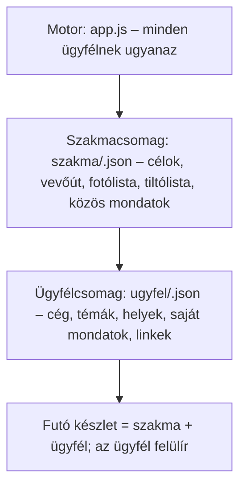

# Tudáscsomagok – három réteg (Péter jóváhagyta 2026-11-27)

- Betöltés: `fotoposzt/?csomag=<név>` → `ugyfel/<név>.json` + `szakma/<szakma_id>.json` (betolto.js). Régi egyrétegű `csomagok/<név>.json` is megy.
- Összefésülés: tömb `id` szerint, szótár kulcsonként; **az ügyfél nyer**. A `szakma_meta` a futó készletben `szakma` néven érhető el (a Tervező ebből dolgozik).
- A lapba ágyazott Akvarell-készlet GENERÁLT: `python3 tools/fotoposzt_csomag.py epit`; ellenőrzés: `--ellenoriz` és `node tools/proba/fotoposzt_t27.mjs` (a kapu része). Kézzel ne szerkeszd az index.html keszletét.
- Szakmák: `szallas` (Akvarell), `autokereskedes` (váz, ügyfél nélkül – az ágazatfüggetlenség próbája).
- Új ügyfél: `ugyfel/<név>.json` `{"szakma_id": "...", "ceg": {...}, "temak": [...], ...}`; új szakma: `szakma/<id>.json` `szakma_meta` kötelező mezőkkel (id, nev, celok, fotolista, cta, tilos), ügyféladat (`ceg`) nem lehet benne.

## A régi egyrétegű leírás (a mezők jelentése változatlan)

Egy csomag = egy ügyfél tudása (`<név>.json`). Betöltés: `fotoposzt/?csomag=<név>` (név: kisbetű, szám, kötőjel; max 40).
Ha nincs `?csomag=`, a lapba ágyazott alapcsomag (Akvarell) fut. Hibás vagy hiányzó csomagnál is az alapcsomag fut, figyelmeztetéssel.

## Szerkezet
Ugyanaz, mint a `fotoposzt/index.html` `<script id="keszlet">` JSON-ja:
`ceg`, `temak`, `nyito`, `hangulat`, `tudtad`, `teny`, `zaro`, `komment`, `url`, `mintak`, `helyek`, `helyek_forras`, `haz_kozelito`, `szin`, `seta`.
Kötelező: `ceg.hely`, `temak` (tömb).

## `ceg` – a cég adatai (ezekből megy a felület, a kép felirata, az AI-prompt)
| mező | példa (Akvarell) | hol látszik |
|---|---|---|
| nev | Akvarell Apartmanház | fejléc, poszt-előnézet |
| rovid | Akvarell | képfelirat, lap címe |
| alcim | APARTMANHÁZ · ZEBEGÉNY | képfelirat második sora |
| kiscim | ZEBEGÉNY | képeslap-bélyeg |
| logobetu | A | fejléc-logó (ha nincs feltöltött logó) |
| hely.hu/en/de | Zebegény | szövegek, témacsoport neve |
| hely.ben/bol/t/tol | Zebegényben / Zebegényből / Zebegényt / Zebegénytől | magyar ragozott alakok |
| koord | [47.8001, 18.9094] | napkelte/napnyugta, fotó távolsága |
| prompt_ki | Az Akvarell Apartmanház (Zebegény, Dunakanyar) | AI-prompt első mondata |
| persona | Te vagy a ház két kedves házigazdája. | AI-prompt hangja |
| kampany | akv-foto | `utm_campaign` a foglalási linkben |
| ai_link | https://claude.ai/artifact/… | a Cloudflare-oldalon link a közvetlen AI-s változatra (ha nincs, nem látszik) |

A foglalási link a `url` mezőből jön (`""` = alap, apartmanonként külön kulcs).
A felismerő referenciaképei (`felismero/helyek-emb.json`) még közösek; csomagonkénti felismerő a következő lépés.
